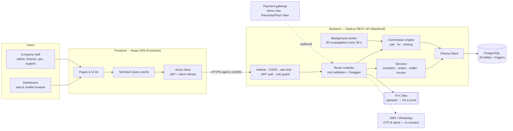
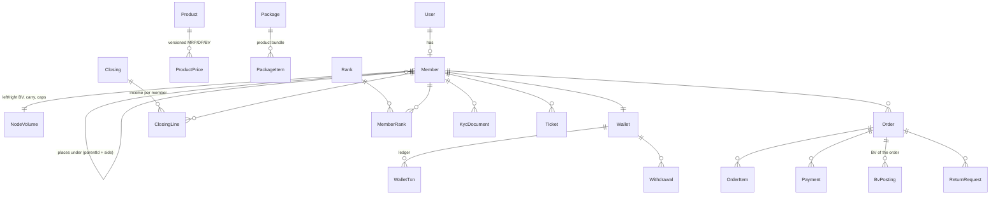
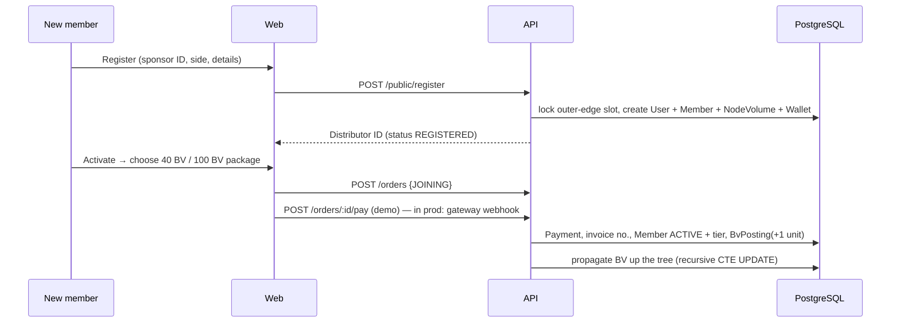
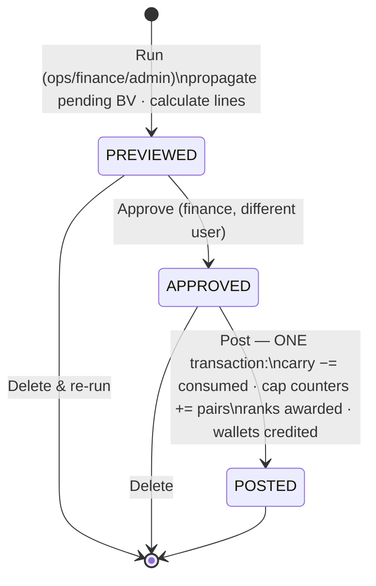
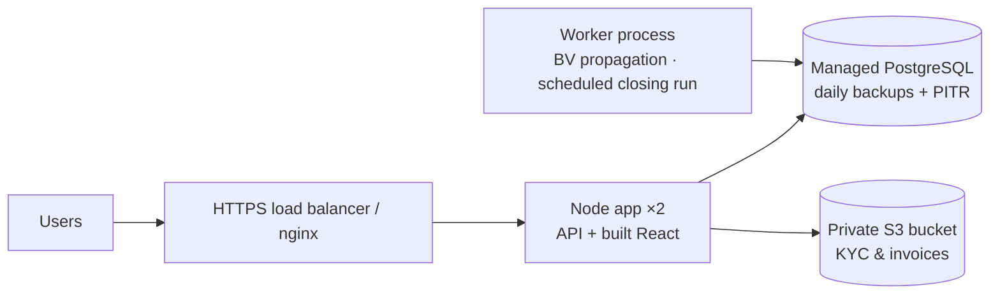

# Solution Architecture: Navarth Wellness Distributor Portal

Version 1.0 · October 2026

## 1. Overview

| Layer | Choice | Why |
|---|---|---|
| UI | React 18, TypeScript, Vite, Tailwind v4 | Fast dev server, type safety, mobile-first styling |
| Data fetching | TanStack Query + Axios | Caching, background refresh, one place for auth/refresh |
| API | Express 5 + TypeScript | Simple, widely known; async errors handled natively |
| Contract | zod → OpenAPI 3 (Swagger UI at `/api/docs`) | One schema validates requests **and** generates the docs |
| Data access | Prisma 6 (pg driver adapter) | Typed queries, migrations, transactions |
| Database | PostgreSQL 15+ | ACID money transactions, recursive CTEs for the tree, JSONB for settings |

## 2. Security model

| Concern | Implementation |
|---|---|
| Login | Distributor ID / mobile / email + bcrypt password; rate-limited (50 / 15 min / IP) |
| Session | 15-minute **access JWT** kept in memory. 7-day **refresh token** in an httpOnly cookie (path `/api/v1/auth`), rotated on every use, stored as a SHA-256 hash, revocable |
| Authorisation | 7 roles: `MEMBER`, `FRANCHISE`, `ADMIN_SUPER`, `ADMIN_OPS`, `ADMIN_FINANCE`, `COMPLIANCE`, `SUPPORT`. Each route declares its roles (shown in Swagger). Members can only read their own data and downline |
| Sensitive data | PAN and bank account numbers encrypted with AES-256-GCM. Aadhaar stored **masked** only. Bank numbers shown in full only to Super Admin / Finance |
| KYC files | Stored outside the web root and served only through an authenticated endpoint to the owner or staff |
| Money safety | Maker-checker on closings; withdrawals debit the wallet atomically (`balance >= amount` checked in the same UPDATE); a unique `(refType, refId, type)` index stops double credits |
| Audit | Every login, admin change and money movement goes to `AuditLog`. With `extras.sql`, `AuditLog`, `WalletTxn`, `BvPosting` and `PlanSetting` become append-only at database level |

## 3. Data model (main entities)

Design rules:

- **Binary tree** = `parentId` + `side`, with a unique `(parentId, side)` index so a slot can never hold two people. Placement takes a row lock (`SELECT … FOR UPDATE`) and retries once on a race.
- **Upline and downline** are walked with PostgreSQL **recursive CTEs**, so any tree depth works without a closure table.
- **`NodeVolume`** holds running totals (lifetime BV per leg, unmatched carry by tier, cap counters). Dashboards read one row and never recompute the tree.
- **Ledgers are append-only.** Corrections are new rows (a negative `BvPosting`, a reversing `WalletTxn`).
- **Order lines copy price and BV** at purchase time, and product prices are versioned, so old invoices never change.
- **All plan numbers** (pair rates, caps, TDS, cooling-off, feature switches) live in versioned `PlanSetting` rows, not in code.

## 4. Business flows

### 4.1 Registration → activation

### 4.2 Pair-matching rules (from the plan slides)

| Earner | Matched left | Matched right | Income |
|---|---|---|---|
| 100 BV | 100 BV | 100 BV | ₹400 |
| 100 BV | any 40 BV involved | | ₹200 |
| 40 BV | any | any | ₹200 |

- Each activated joining is one **unit** in its leg, counted by tier (FULL = 100 BV, BASIC = 40 BV). Full:full pairs are matched first, and BASIC units are used before FULL ones.
- **Caps:** 30 pairs a day, 210 a week and 840 a month (IST calendar). Pairs over the cap are **flushed** by default; this can be switched to carry.
- Unmatched units carry forward to the next closing.
- **Ranks** use lifetime BV on the **weaker** leg against the rank threshold. Each rank pays its bonus once, plus the women/divyang special bonus from Diamond (rank 8) upward for verified members.
- Code: `Backend/src/engine/pair.ts` (pure functions, with 10 unit tests from the plan's scenario table).

### 4.3 Closing (daily payout run)

Each line keeps its full calculation in `ClosingLine.detail`: carry before and after, units used, cap remaining and rates. Distributors see this in **Income → (row)**.

### 4.4 Withdrawal

The member requests a withdrawal. The checks are: KYC approved, bank added, wallet not on hold, at least the minimum amount, and optionally an allowed weekday. Then TDS and admin charge are worked out from the settings and the wallet is debited at once. Finance then approves, downloads the bank CSV, and marks it **paid** with the UTR. If finance **rejects** it, the amount is credited back to the wallet.

### 4.5 Return / buy-back

The member requests a return within the cooling-off period. When ops approves it, these happen in one step:

- the payment is refunded
- the stock is put back
- a **negative BvPosting** is propagated up the tree
- a returned joining order sets the member back to *REGISTERED*

Clawing back commission already paid is a policy decision that is still open; post it as an `ADJUSTMENT` line.

## 5. API surface

71 documented endpoints. Full detail is in Swagger at `/api/docs`.

| Area | Base path | Examples |
|---|---|---|
| Auth | `/auth` | login, refresh, logout, me, change-password, forgot-password |
| Public | `/public` | sponsor lookup, register, products (MRP), company & grievance info |
| My account | `/me` | dashboard, profile, bank, nominee, ranks |
| Network | `/genealogy` | tree (depth 1–5), directs, team by leg |
| KYC | `/kyc` | upload (multipart), list, secure file download |
| Catalogue | `/catalog` | products (MRP/DP/BV), packages, ranks |
| Orders | `/orders` | create, pay (demo), my orders, detail, invoice (HTML), return |
| Money | `/finance` | income lines, wallet ledger, withdrawals |
| Support | `/tickets` | list, create, thread, reply |
| Admin | `/admin/*` | dashboard, users, members, kyc, products, packages, ranks, orders, returns, closings, withdrawals, settings, reports (CSV), tickets, audit-logs |

Response envelope: `{ "data": … }` for success and `{ "error": { "code", "message", "details" } }` for errors. Paged lists return `{ items, total, page, pageSize }`. Money is sent as decimal **strings** and never handled as floating point on the server.

## 6. Frontend structure

- `AuthProvider` restores the session on load through the refresh cookie. Axios retries any 401 once after a shared refresh call, so parallel requests never race.
- Route guards: `/app/*` is for distributors and `/admin/*` for staff. Admin menu items are filtered by role.
- `ui.tsx` holds the reusable kit: buttons, fields, cards, stat cards, status badges, data table, pagination, modal, tabs, toasts and progress bars.
- Charts use Recharts with one series per chart, a single axis and a colourblind-validated palette.
- Language: English / हिंदी toggle (`i18n/index.tsx`). It covers navigation and the login screens and can be extended page by page.
- Pages are lazy-loaded per area, so the initial download stays small.

## 7. Deployment (recommended)

- Host in an **Indian region** (for example AWS Mumbai) for data residency.
- Run `npm run build`; `npm start` then serves the API and the SPA from one process.
- Move the 30-second propagation loop and an automatic 23:59 IST closing *run* (approval stays manual) into a separate worker, using pg-boss or a cron job.
- Set up monitoring alerts for: a failed closing, payout above the alert % of sales, webhook failures, and 5xx errors.

## 8. Known limits and next steps

| Item | Status |
|---|---|
| Payment gateway | Demo button. Add Razorpay/PayU/Cashfree checkout plus a signed webhook calling `markOrderPaid()` |
| OTP (register, bank change, withdrawal) | Not wired. Add an SMS/WhatsApp provider and an `OtpCode` flow (the table already exists) |
| Leadership bonus, level reward, royalty CTO, Jeevan Suraksha | Switches exist in Plan Settings; calculations are to be added once the company signs off the rules |
| Autopool, "₹7,500 after 2 directs" | **Off.** Legal review required before building |
| Closing performance | Posting runs one transaction per closing. For more than 1 lakh lines, batch the posting (chunks of 1,000) |
| Mobile app | The web app is responsive. A Flutter/React Native app can reuse the same API |
